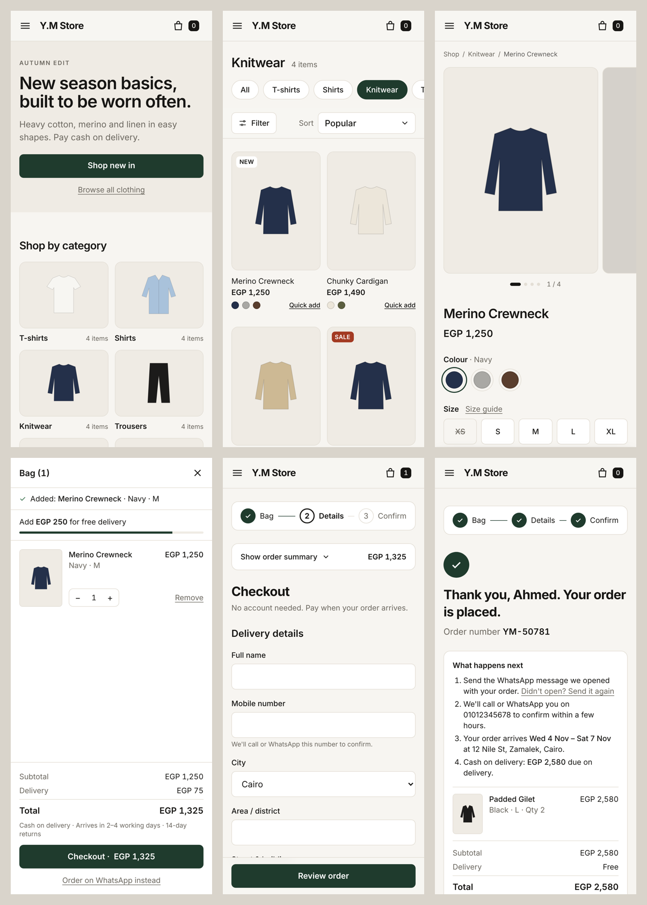

# Y.M Store: online clothing store demo

A demo storefront for **Y.M Store** ([Instagram @y_m_storee](https://www.instagram.com/y_m_storee)). It's built with
Next.js 15 (App Router), React 19, TypeScript and Tailwind CSS v4.

The design draws on a survey of 18 leading fashion stores and published e-commerce UX research. The design rules come from the
UI/UX notes in [`docs/uiux-notes.md`](docs/uiux-notes.md):
- one main action per screen
- one flat accent colour
- the next card peeks in carousels
- a connected checkout stepper
- 16px inputs
- 44px touch targets
- no horizontal scroll at 375px



## Run it

```bash
npm install
npm run dev        # http://localhost:3000
npm run build      # production build
```

## Pages

| Route | What it does |
|---|---|
| `/` | Hero with one call to action, 6 category tiles, "New in" carousel, inline delivery and returns info, popular items |
| `/shop`, `/shop/[category]` | Sticky filter bar (size first, colour, fit, price, on sale), sort, removable filter chips; filters are kept in the URL |
| `/product/[slug]` | Gallery, colour and size buttons, size guide dialog, Add to bag, Order on WhatsApp, delivery date, sticky add bar on mobile |
| Bag drawer | Free-delivery progress, quantity controls, totals, Checkout or WhatsApp |
| `/checkout` | Guest checkout with 8 fields or fewer and cash on delivery. "Place order" sends the order to the store on WhatsApp with an order number |

## Swap in the real store data

Everything below is a **placeholder**: products, prices (EGP), city list, WhatsApp number and delivery rules.

- `lib/store-config.ts`: name, WhatsApp number, currency and locale, LTR or RTL, delivery fee and free-delivery threshold, returns window
- `data/products.ts`: categories and products (sizes and stock, colours, fit, material)
- `public/products/`: product photos. Add their paths to a product's `images` array. Products without photos show a drawn garment shape
- `lib/delivery.ts`: working days for delivery estimates
- `components/checkout/fields.ts`: city list and payment options

The layout uses logical CSS properties, so setting `dir: "rtl"` mirrors it for Arabic. The text is not translated yet.

## Research

- [`research/fashion-ecommerce-survey.md`](research/fashion-ecommerce-survey.md): combined ranking and the patterns we adopted
- [`research/a-browse.md`](research/a-browse.md), [`research/b-pdp-checkout.md`](research/b-pdp-checkout.md) and
  [`research/c-evidence.md`](research/c-evidence.md): the detailed reports with sources
- [`docs/screenshots/`](docs/screenshots/): every page at 375px and 1280px
