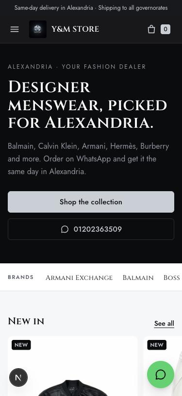
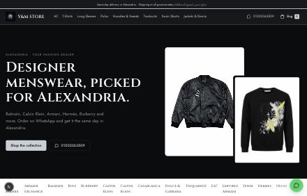

# Y&M STORE: men's designer clothing, Alexandria

The storefront for **Y&M STORE** ([Instagram @y_m_storee](https://www.instagram.com/y_m_storee)). It's built with
Next.js 15 (App Router), React 19, TypeScript and Tailwind CSS v4.

The design draws on a survey of 18 leading fashion stores and published e-commerce UX research. The design rules come from the
UI/UX notes in [`docs/uiux-notes.md`](docs/uiux-notes.md):
- one main action per screen
- one flat accent colour
- the next card peeks in carousels
- a connected checkout stepper
- 16px inputs
- 44px touch targets
- no horizontal scroll at 375px

 

## Run it

```bash
npm install
npm run dev        # http://localhost:3000
npm run build      # production build
```

## Pages

| Route | What it does |
|---|---|
| `/` | Hero with one call to action, 6 category tiles, "New in" carousel, inline delivery and returns info, popular items |
| `/shop`, `/shop/[category]` | Sticky filter bar (size first, colour, fit, price, on sale), sort, removable filter chips; filters are kept in the URL |
| `/product/[slug]` | Gallery, colour and size buttons, size guide dialog, Add to bag, Order on WhatsApp, delivery date, sticky add bar on mobile |
| Bag drawer | Free-delivery progress, quantity controls, totals, Checkout or WhatsApp |
| `/checkout` | Guest checkout with 8 fields or fewer and cash on delivery. "Place order" sends the order to the store on WhatsApp with an order number |

## Store data

The real Y&M STORE catalogue and contacts (from Instagram @y_m_storee and the Facebook page, collected 2026-11-03):

- `data/catalog.json`: 54 products built from the store's 2026 posts. One product = one post + item + brand, with each colourway's
  front/back photos (`public/products/`, 112 photos). **Prices aren't published**: `"price": 0` shows "Price on WhatsApp".
  Type a number in EGP to show a price; the cart, checkout and WhatsApp message pick it up.
- `data/products.ts`: categories, and **placeholder sizes** (S–XXL all available) until real stock is known.
- `lib/store-config.ts`: address (Arabic + English), map, phones, WhatsApp number and group, Instagram, Facebook, Threads,
  delivery (same day in Alexandria, all governorates) and payment (cash or Visa).
- `components/product/size-data.ts`: a general size guide, not measured from these items.

The layout uses logical CSS properties, so setting `dir: "rtl"` mirrors it for Arabic.

## Research

- [`research/fashion-ecommerce-survey.md`](research/fashion-ecommerce-survey.md): combined ranking and the patterns we adopted
- [`research/a-browse.md`](research/a-browse.md), [`research/b-pdp-checkout.md`](research/b-pdp-checkout.md) and
  [`research/c-evidence.md`](research/c-evidence.md): the detailed reports with sources
- [`research/d-ym-redesign.md`](research/d-ym-redesign.md): black/metal palette, WhatsApp ordering, Egyptian delivery and payment, Arabic
- [`docs/screenshots/`](docs/screenshots/): `ym-*` are the current design; the rest show the earlier demo
